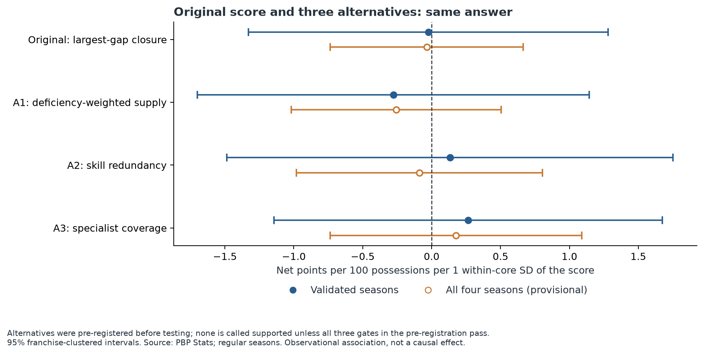

# NBA Lineup Fit Analysis

**Does filling a four-player lineup's biggest skill gap help a team more than simply adding the better player?**

## Findings

> **No reliable evidence that it does.** Across four NBA seasons (2022–23 to 2025–26), a fifth player who closes the core's largest measured skill gap shows no benefit beyond that player's prior production and skills. This is a narrow result about one definition of fit, not a finding that fit is unimportant.

| Sample | Effect per 0.1 gap closed (net points per 100 possessions) | 95% interval | Lineups |
|---|---:|---:|---:|
| **2022–23 and 2023–24 (independently validated, preferred)** | **−0.03** | **[−1.63, +1.57]** | 808 |
| All four seasons (two are provisional) | −0.04 | [−0.91, +0.82] | 1,537 |

- **Association, not causation.** The estimates compare fifth players who actually shared the floor with the same four-player core. Coaches chose those lineups.
- **No prediction gain.** Trained on earlier seasons and scored on the next, adding fit changes prediction error by +0.0024 (2023–24), +0.0001 (2024–25) and −0.0001 (2025–26). Pooled change +0.0009, interval [−0.0057, +0.0069]. This is prediction of within-core differences only.
- **Both intervals include zero** (bootstrap p-values 0.96 and 0.90). The data cannot rule out modest effects either way.
- **Three better-motivated scores say the same.** Written down before testing, none is supported: the best-motivated one (A1, which credits skill wherever the core is weak) gives −0.28 net points per 100 possessions per SD, interval [−1.70, +1.14], and all three have adjusted p-values of 1.00.


## The Knicks example: why Jalen Brunson scores zero

In 2024–25 one Knicks core was **Karl-Anthony Towns, OG Anunoby, Josh Hart and Mikal Bridges**. Judged on the prior season, its largest gap is **blocks** (0.34 SD below average). Jalen Brunson's block rate cannot close it, so his fit score is **zero**, even though his creation (+3.46 SD) and playmaking (+1.61 SD) are elite. Miles McBride, Cameron Payne and Delon Wright also score zero, so the metric cannot tell the four apart. A zero is not a verdict on Brunson; it shows how narrow the metric is. Of the primary-sample rows, 39.3% score exactly zero, and fit correlates 0.30 with the talent proxy.


The alternative score A1 does separate the four: Brunson +0.84, McBride −0.53, Payne −0.16, Wright −0.12. It is not a better predictor of lineup results, though.



## What Does This Actually Mean for NBA Fans?

Teams talk about fit because a lineup of five great shooters has no rebounder and one with no creator stalls. This study measured the simplest version: find the skill a four-player core lacks most, and ask whether the fifth player who fills it beats a fifth player who is simply better. In these four seasons, he did not. That does not show chemistry is fake; it shows one crude measure of fit adds nothing beyond talent and skills, and that lineup data is noisy. For fans, the safe takeaway is that talent and minutes dominate, and fit claims deserve evidence. For coaches and front offices, this score should not pick players. What remains open is whether better measures (tracking data, defensive impact, shooting gravity) find what box scores cannot. [Full explanation with the Knicks example.](docs/fans.md)

## Method

- **Comparison:** different fifth players observed beside the same season-team four-player core (core fixed effects), weighted by possessions, with uncertainty clustered by franchise.
- **Fit score:** how much the fifth player closes the core's single largest below-average gap among five skills (spacing, playmaking, creation, rebounding, blocks), capped at average.
- **Controls:** the fifth player's prior-season Game Score per 36 and all five skills. Skills come from the previous season only.
- **Sample:** at least 50 possessions on each side, prior profiles with 500 or more minutes for all five players, and at least two observed fifth players per core: 1,537 lineups, 30 franchises.
- **Metric check:** the score is crude (39.3% of rows are exactly zero), so three alternatives were written down in advance ([pre-registration](docs/metric_preregistration.md)) and tested with a fixed decision rule. All results are in the [audit](docs/FINAL_AUDIT.md).

## Limitations

- **Provisional data.** Provider totals fail an independent check in 2024–25 and 2025–26. In 2024–25 the provider's points scored fall 57 short on 11 teams, including 12 for the Knicks. In 2025–26 defensive possessions run 0.73 percentage points above offensive ones relative to every earlier season (1,850 league-wide). The two earlier seasons pass; the preferred estimate uses only those. See the [audit](docs/FINAL_AUDIT.md).
- **Crude proxies.** Blocks are not defense. Game Score is not impact. Rookies and low-minute players are excluded.
- **Selection.** Coaches choose lineups; injuries, opponents and matchups are not modeled.
- **Width.** The intervals leave room for effects of either sign. For the validated seasons, effects up to 1.0 net points per 100 possessions per SD cannot be ruled out.
- **Checks that passed:** 30 teams and 82 games each in every season, team minutes and pace in plausible ranges, and player totals within 1% of team totals. One player appears on four teams in 2025–26 and is flagged. See the audit.

## Reproduce

```bash
python3 -m venv .venv
.venv/bin/python -m pip install -r requirements-lock.txt
.venv/bin/python -m unittest discover -s tests -v
.venv/bin/python run.py --download --workers 2 --release --notebooks
```

Windows: use `.venv/Scripts/python`. Full steps, including the final audit commands, are in [docs/REPRODUCING.md](docs/REPRODUCING.md). Bulk data are not in Git; the provider's API can be slow, and retries reuse the cache.

## More

[Final audit](docs/FINAL_AUDIT.md) · [Research report](docs/research_report.md) · [Methodology](docs/methodology_notes.md) · [Fan explanation](docs/fans.md) · [Article draft](docs/medium_article_outline.md) · [Static site](site/index.html) · [Career summary](docs/career_materials.md) · [Original pilot](docs/pilot_readme.md) · [Publishing](docs/PUBLISHING.md)

Seven notebooks are in `notebooks/`, analysis code in `src/`, tests in `tests/`, and machine-readable results in `docs/`.
