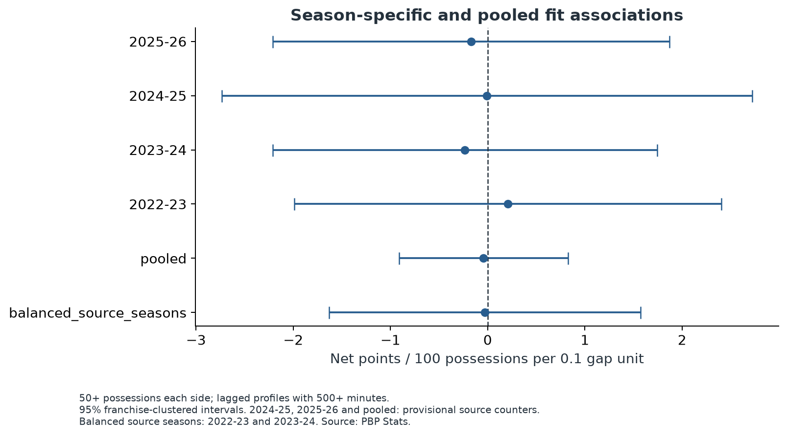
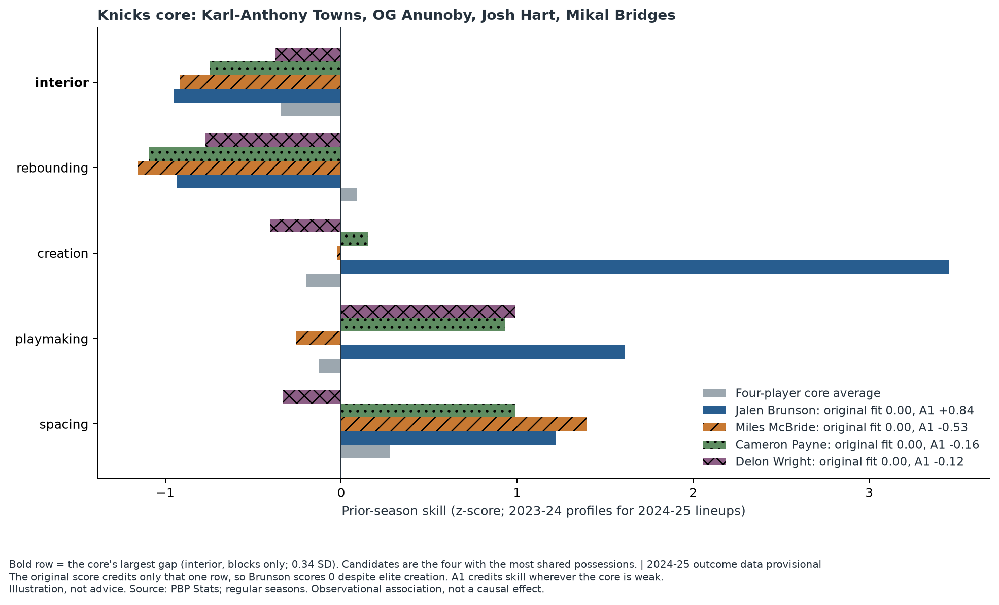

<!-- Paste-ready article draft (this file is also the outline: its headings follow the planned order). Upload the figures named in each section from /figures when pasting into Medium. -->

# Best Player or Best Fit? I Tested the Idea That Teams Should Fill Their Biggest Weakness

*I'm a Knicks fan, and I wanted to know whether "he fits" is a real basketball argument or just a nice story. So I tested it on four NBA seasons of lineup data.*

## Best player or best fit?

Every offseason the same argument shows up. One side says take the most talented player on the board. The other says take the player who fits: the one who covers what your best four already lack. Fit sounds obviously right. If your starters can't rebound, add a rebounder. If nobody can create a shot, add a creator.

But "obviously right" is exactly when it's worth checking. A very good player is probably useful almost anywhere. So the real question is whether filling a team's biggest hole is worth anything *beyond* just adding the better player.

## Why complementarity might matter

The basketball logic is easy to believe. Skills have diminishing returns: a fifth shooter on a team full of shooters adds less than the first one did. Weaknesses get exploited: a lineup that can't protect the rim gives up easy shots all night. Good coaches talk this way constantly.

So I turned it into something I could measure. For any four-player group, I scored five skills using the previous season's numbers: spacing, playmaking, creation, rebounding and blocks. Each score says how far the group's average sits above or below the league. The skill where the group is furthest below average is its biggest gap. Then, for each possible fifth player, I asked how much of that gap he fills.

## How I tested it

The trick is to compare fairly. Many fifth players shared the floor with the same four teammates over a season. So I compared lineups that share the same four and differ only in the fifth player. Then I asked whether the lineup did better when its fifth player filled more of the gap, after accounting for how good that player was overall and what his individual skills were. Lineups with more minutes counted for more. All numbers come from four regular seasons, 2022–23 through 2025–26, and 1,537 lineups with enough minutes to mean something.

I also checked the data itself against an independent source. Two seasons passed. In 2024–25 the data provider's points scored fell 57 short across 11 teams, including 12 for the Knicks. In 2025–26 the provider's defensive possession counts ran high relative to every earlier season. So I report the two clean seasons as my main answer and treat the other two as provisional.

## What I found

Nothing. Filling the biggest gap did not help beyond what the player's overall quality and skills already explained.

In the two clean seasons the estimate is −0.03 net points per 100 possessions for each 0.1 of gap closed, with a 95% range from −1.63 to +1.57. Using all four seasons it is −0.04, from −0.91 to +0.82. Those ranges include zero comfortably. The score also did not help predict how lineups performed the following season: the change in prediction error was +0.0009, with a range from −0.0057 to +0.0069.

This is a real result, not a failed one. It says that this version of "fit" did not beat "just play the better player" in these data. It does not say the effect is exactly zero: the ranges are wide enough to hide a modest benefit or a modest cost.

## A real lineup: the Knicks and Jalen Brunson

In 2024–25, one Knicks core was Karl-Anthony Towns, OG Anunoby, Josh Hart and Mikal Bridges. Judged on the previous season, their biggest gap is blocks, and it is small: 0.34 standard deviations below average.

Now add Jalen Brunson. His creation score is +3.46 standard deviations, and his playmaking is +1.61. By any basketball standard he is an elite fit for what a four-man group needs to function. But my score gives him exactly **zero**. His block rate can't fill the blocks gap, and the score only looks at the single biggest gap. Miles McBride, Cameron Payne and Delon Wright also get zero. The score can't tell any of them apart.

That is not a verdict on Brunson. It is a verdict on the score. Of the lineups I analyzed, 39.3% scored exactly zero, and the score correlates only 0.30 with the player's overall quality. I wrote down three better-motivated alternatives before testing them, to avoid choosing a version that happened to look good, and I report all of them in the project's audit.

## What Does This Actually Mean for NBA Fans?

Teams talk about fit because a lineup of five great shooters has no rebounder, and one with no creator stalls. I measured the simplest version of that idea and it added nothing beyond talent and skills. That does not mean chemistry is fake. It means one crude, box-score-based measure of fit didn't show up in the data, and lineup data is noisy.

What can you take from it?

- **As a fan:** talent and minutes explain most of what you see. When someone says a player "fills a hole," ask what they measured.
- **As a coach:** don't pick a fifth starter with a gap score like this one. It can't even separate Brunson from McBride.
- **As a front office:** the data can't show that paying for fit works, but it can't rule out a modest benefit either. Keep scouting judgment in the room.

What's still unanswered is whether better measures (tracking data, defensive impact, shooting gravity) find a fit effect that box scores can't.

## Limits

Coaches choose lineups, so this is a comparison of what happened, not an experiment. Blocks are not defense; Game Score is not impact; rookies and low-minute players are left out. Two of the four seasons have unresolved data problems. And the result describes association: it can say whether a score lines up with performance, not whether adding a player changes anything on its own.

## Takeaway

Fit is a good story. In four seasons of data, one honest way of measuring it didn't beat "play the better player." That is worth knowing, and it is worth knowing why: the measure was crude, the data was noisy, and the question is still open. The code, audit and data checks are public in the project repository.
